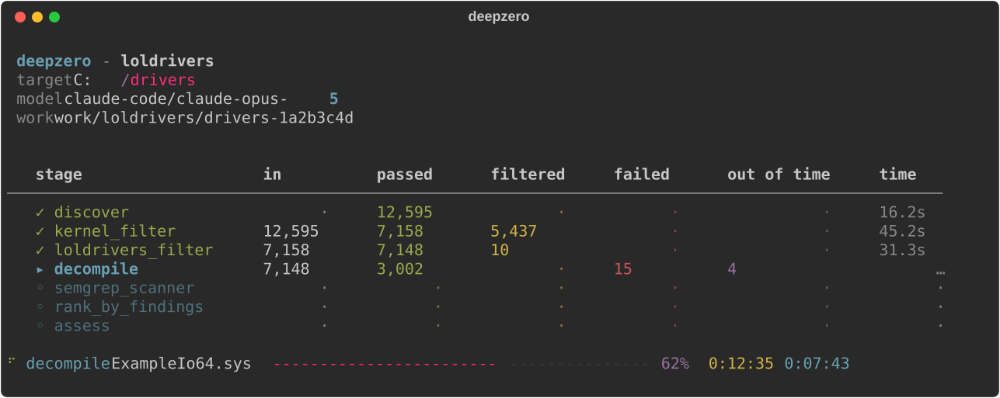
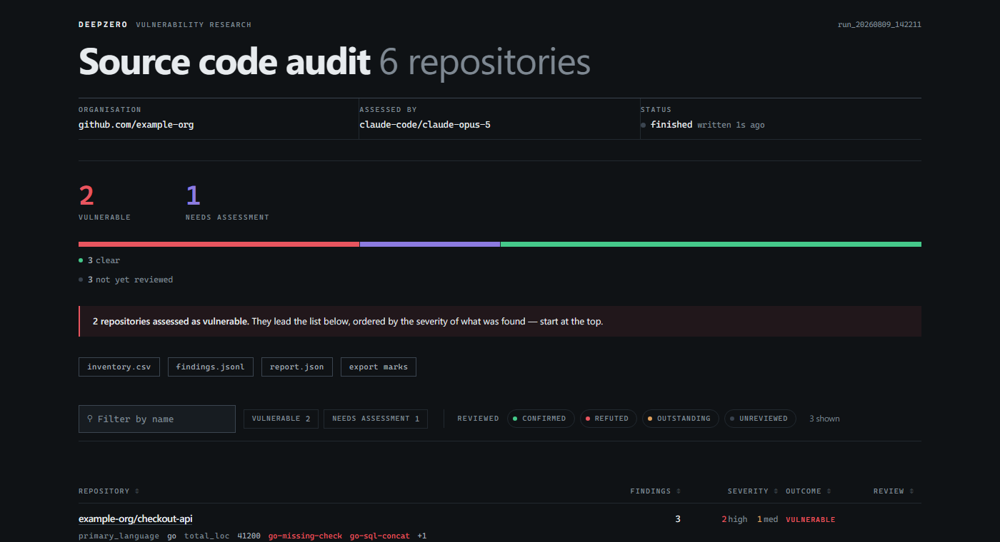

<div align="center">
  <br>
  
  <br><br>
  <p><b>Moteur de pipeline de recherche de vulnérabilités automatisé</b></p>
  <p>Définissez des pipelines via YAML. DeepZero gère l'orchestration, le parallélisme, la tolérance aux pannes et l'état.</p>
  <p>
    <a href="https://github.com/416rehman/DeepZero/actions"></a>
    <a href="https://github.com/416rehman/DeepZero/blob/main/LICENSE"></a>
    <a href="https://blog.ahmadz.ai/DeepZero/fr/"></a>
    
    
  </p>
</div>

<br>

<div align="center">
  
</div>

<br>

<div align="center">
  
  <br>
  <sub>Chaque exécution écrit un rapport consultable et le tient à jour pendant qu'elle se déroule. Données fournies à titre indicatif.</sub>
</div>

<br>

<div align="center">
  <a href="README.md">English</a> | <a href="README.zh-CN.md">简体中文</a> | <b>Français</b>
</div>

<br>

- 🔗 **Pipeline en YAML** - enchaînez de manière déclarative les étapes d'ingestion, de filtrage, de transformation et d'évaluation LLM
- ⚡ **Exécution parallèle** - ThreadPoolExecutor avec une concurrence configurable par étape
- 💾 **Exécutions reprenables** - état atomique par échantillon sur le disque, cloisonné par corpus ; appuyez sur Ctrl+C et relancez pour reprendre là où vous vous étiez arrêté
- 🤖 **Intégration LLM** - modèles de prompts Jinja2, avec au choix une clé d'API via [LiteLLM](https://github.com/BerriAI/litellm) ou votre abonnement Claude Code et aucune clé d'API du tout
- 📊 **Rapports consultables** - `deepzero report` construit un rapport HTML autonome à partir de l'état de l'exécution ; chaque pipeline nomme lui-même ses entités et ses verdicts
- 🌐 **API REST (WIP)** - interrogez l'état de l'exécution et les données d'échantillons via HTTP (actuellement expérimental et incomplet)
- 🧩 **Extensible** - écrivez des processeurs personnalisés sous forme de classes Python, et référencez-les par leur chemin dans YAML

---

## 📚 Documentation

DeepZero dispose d'une documentation exhaustive couvrant l'architecture, les schémas de pipeline, les références de la CLI et le développement de processeurs personnalisés.

👉 **[Lisez la documentation officielle ici](https://blog.ahmadz.ai/DeepZero/fr/)**

---

## ⚡️ Démarrage Rapide

DeepZero nécessite un corpus cible à analyser et une configuration de pipeline détaillant comment le traiter.

1. **Cloner & Installer (Python 3.11+)**
   ```bash
   git clone https://github.com/416rehman/DeepZero.git
   cd DeepZero
   pip install -e .
   ```

2. **Configurer l'Environnement**
   ```bash
   cp .env.example .env
   ```
   Les deux pipelines fournis déclarent `model: claude-code/claude-opus-5`, qui pilote la CLI Claude Code à laquelle vous êtes déjà connecté. Utilisez `-m` pour n'importe quel modèle LiteLLM à la place.

3. **Exécuter un Pipeline**
   ```bash
   # des pilotes noyau sur le disque
   deepzero run C:\drivers -p .\pipelines\loldrivers\pipeline.yaml --preflight

   # ou du code source, depuis un manifeste de dépôts ou un répertoire de copies de travail
   deepzero run repos.txt -p .\pipelines\source_audit\pipeline.yaml
   ```
   `--preflight` confirme que le backend LLM est prêt avant que les étapes coûteuses ne s'exécutent, plutôt que de l'apprendre des heures plus tard, à la première étape d'évaluation.

4. **Lire les Résultats**
   ```bash
   deepzero report -p loldrivers --open
   ```
   Peut être exécuté sans risque pendant une exécution. Le rapport est construit à partir de l'état de l'exécution : il peut donc être supprimé et reconstruit à tout moment.

Pour des instructions de configuration détaillées et des exemples de corpus, consultez la [Documentation de Démarrage Rapide](https://blog.ahmadz.ai/DeepZero/fr/overview/quickstart.html).

---

## 📁 Structure du Dépôt

```text
src/deepzero/
├── api/                 # API REST (starlette)
├── engine/              # orchestration, persistance de l'état, exécution du pipeline
└── stages/              # processeurs intégrés (map, reduce, ingest)

processors/              # processeurs externes (fournis comme exemples)
├── ghidra_decompile/    # décompilateur headless ghidra (MapProcessor)
├── git_ingest/          # découverte et clonage de dépôts git (IngestProcessor)
├── loldrivers_filter/   # filtre d'exclusion de hachage loldrivers.io (MapProcessor)
├── pe_ingest/           # parseur d'en-tête PE et extracteur de métadonnées (IngestProcessor)
└── semgrep_scanner/     # scanneur de lots semgrep (BulkMapProcessor)

pipelines/
├── loldrivers/          # pipeline de recherche de vulnérabilités pour les pilotes noyau BYOVD
│   ├── pipeline.yaml
│   ├── assessment.j2    # modèle de prompt LLM
│   └── rules/           # règles semgrep
└── source_audit/        # audit de code source sur des dépôts git
    ├── pipeline.yaml
    ├── assessment.j2    # modèle de prompt LLM
    └── rules/           # 136 règles semgrep couvrant huit langages

docs/                    # Documentation GitHub Pages basée sur Jekyll
tests/                   # suite de tests pytest
```

---

## 🤝 Contribuer

L'intégration continue (CI) s'exécute sur Python 3.11 et 3.12 via GitHub Actions.

Exécutez les vérifications de linting et de sécurité avant de soumettre :

```bash
ruff check . && ruff format --check . && bandit -ll -ii -c pyproject.toml -r .
```

Veuillez consulter le [Guide de Contribution](CONTRIBUTING.md) et le [Code de Conduite](CODE_OF_CONDUCT.md) avant de soumettre une pull request.

---

## 📄 Licence

DeepZero est publié sous la [Licence MIT](LICENSE).
