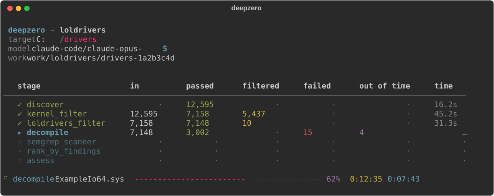
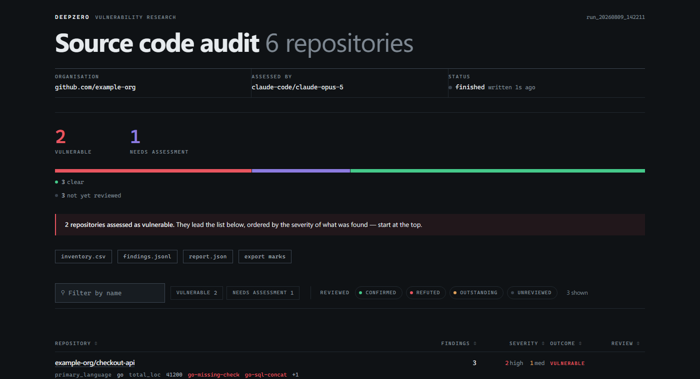
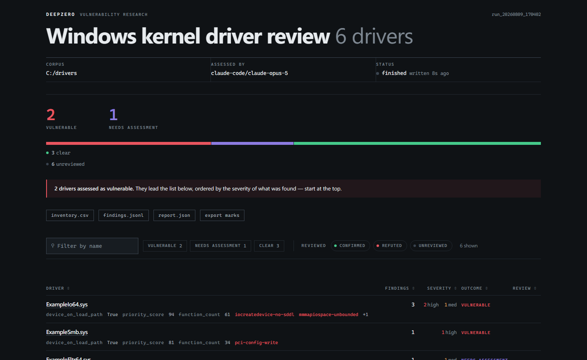

<div align="center">
  <br>
  
  <br><br>
  <p><b>Automated vulnerability research pipeline engine</b></p>
  <p>Define pipelines in YAML, process samples in parallel, and resume interrupted runs.</p>
  <p>
    <a href="https://github.com/416rehman/DeepZero/actions"></a>
    <a href="https://github.com/416rehman/DeepZero/blob/main/LICENSE"></a>
    <a href="https://blog.ahmadz.ai/DeepZero/en/"></a>
    
    
  </p>
</div>

<br>

<div align="center">
  
</div>

<br>

<table align="center">
  <tr>
    <td width="50%"></td>
    <td width="50%"></td>
  </tr>
</table>

<div align="center">
  <sub>Example reports using sample data.</sub>
</div>

<br>

<div align="center">
  <b>English</b> | <a href="README.zh-CN.md">简体中文</a> | <a href="README.fr.md">Français</a>
</div>

<br>

- **YAML pipelines** - combine ingestion, filtering, transformation, and LLM assessment stages.
- **Parallel execution** - set concurrency per stage.
- **Saved state** - resume interrupted runs from results on disk.
- **Incremental reruns** - changes to prompts, rules, or configuration rerun the affected stage and downstream stages.
- **LLM backends** - use Jinja2 prompts with [LiteLLM](https://github.com/BerriAI/litellm) or the Claude Code CLI.
- **HTML reports** - build a self-contained report with `deepzero report`.
- **Custom processors** - write Python classes and reference them by path in YAML.
- **Experimental REST API** - query run state and sample data over HTTP.

---

## 📚 Documentation

[Architecture, pipeline configuration, CLI reference, and custom processors](https://blog.ahmadz.ai/DeepZero/en/).

---

## ⚡️ Quickstart

Requires Python 3.11+. The demo uses included text files and needs no API keys or external tools.

```sh
git clone https://github.com/416rehman/DeepZero.git
cd DeepZero
python -m pip install -e .
deepzero run pipelines/demo/samples -p pipelines/demo/pipeline.yaml
deepzero report -p pipelines/demo/pipeline.yaml --open
```

These commands work in PowerShell and POSIX shells. For an isolated installation, create and activate a Python virtual environment before installing.

The demo keeps one text file, filters out the smaller one, and generates a report. Repeat the `deepzero run` command to resume from saved state. See the [demo walkthrough](pipelines/demo/README.md) for expected results and configuration options.

### Security Pipeline Setup

The two security pipelines need your own target corpus and additional tools. Continue from the cloned repository after the demo; these integrations are optional.

1. **Install Optional Integrations**
   ```bash
   python -m pip install -e ".[full]"
   ```

   The `full` extra includes PE parsing, API-backed LLMs, and the experimental API server. The engine alone needs only `python -m pip install -e .`.

   Run the commands below from the cloned repository. Both security pipelines need **Semgrep** on PATH (`python -m pip install semgrep`) and an LLM backend. The source audit also needs **Git**. The driver pipeline needs **Ghidra**, its supported **JDK**, and `GHIDRA_INSTALL_DIR` pointing to your installation. Install these tools in the environment where DeepZero runs; if using WSL, use its Linux environment consistently.

2. **Configure Environment**
   ```bash
   cp .env.example .env
   ```
   In PowerShell, use `Copy-Item .env.example .env`. Set your own Ghidra path in `.env` for driver analysis.

   Both security pipelines default to `claude-code`, which uses your Claude Code CLI's default model. Install that CLI and sign in with your own account first. To use an API-backed model instead, set its API key and `DEEPZERO_MODEL` in `.env`, or pass `-m`, for example `-m openai/gpt-4o`.

3. **Run a Pipeline**
   ```bash
   # kernel drivers on disk
   deepzero run ./drivers -p pipelines/loldrivers/pipeline.yaml --preflight

   # or source code, from a manifest of repositories or a directory of checkouts
   deepzero run repos.txt -p pipelines/source_audit/pipeline.yaml --preflight
   ```
   Replace `./drivers` with your driver corpus, or create `repos.txt` with one repository URL per line for source audits. These are example inputs; neither is included in the repository.

   Check tool and pipeline prerequisites before starting: `deepzero validate pipelines/loldrivers/pipeline.yaml` (or `pipelines/source_audit/pipeline.yaml`).
   `--preflight` checks the LLM backend before processing starts.

4. **Read the Results**
   ```bash
   deepzero report -p loldrivers --open
   ```
   Reports can be built during or after a run. `deepzero runs` lists runs under `work/`, or another directory passed with `--work-dir`. With no arguments, `deepzero report` uses the only run under `work/` or prompts you to choose if several exist. Use `--work-dir` to select a run in scripts.

For the security pipelines, follow the [full setup guide](https://blog.ahmadz.ai/DeepZero/en/overview/quickstart.html) and [pipeline prerequisites](https://blog.ahmadz.ai/DeepZero/en/reference/included-pipeline.html). Optional integrations require their own dependencies and configuration.

Report bugs or suggest changes in the [issue tracker](https://github.com/416rehman/DeepZero/issues).

---

## 📁 Repository Structure

```
src/deepzero/
├── cli.py               # click command group (run, report, runs, status, validate, ...)
├── api/                 # REST API (starlette)
├── engine/              # orchestration, state persistence, pipeline execution
└── stages/              # built-in processors (map, reduce, ingest)

processors/              # external processors (shipped as examples)
├── ghidra_decompile/    # ghidra headless decompiler (MapProcessor)
├── git_ingest/          # git repository discovery and cloning (IngestProcessor)
├── loldrivers_filter/   # loldrivers.io hash exclusion filter (MapProcessor)
├── pe_ingest/           # PE header parser and driver metadata extractor (IngestProcessor)
└── semgrep_scanner/     # semgrep batch scanner (BulkMapProcessor)

pipelines/
├── demo/                # local first run with harmless text files; no API keys
│   ├── pipeline.yaml
│   └── samples/
├── loldrivers/          # BYOVD kernel driver vulnerability research pipeline
│   ├── pipeline.yaml
│   ├── assessment.j2    # LLM prompt template
│   └── rules/           # semgrep rules
└── source_audit/        # source code audit over git repositories
    ├── pipeline.yaml
    ├── assessment.j2    # LLM prompt template
    └── rules/           # 136 semgrep rules across eight languages

docs/                    # Jekyll-based GitHub Pages documentation
tests/                   # pytest suite
```

---

## 🤝 Contributing

CI tests Linux on Python 3.11–3.14 and Windows on Python 3.12. It also checks linting, security, a real Ghidra installation, and a clean wheel installation.

Run linting and security checks before submitting:

```bash
ruff check . && ruff format --check . && bandit -ll -ii -c pyproject.toml -r .
```

Please refer to the [Contributing Guide](CONTRIBUTING.md) and the [Code of Conduct](CODE_OF_CONDUCT.md) before submitting pull requests.

---

## 📄 License

DeepZero is released under the [MIT License](LICENSE).
