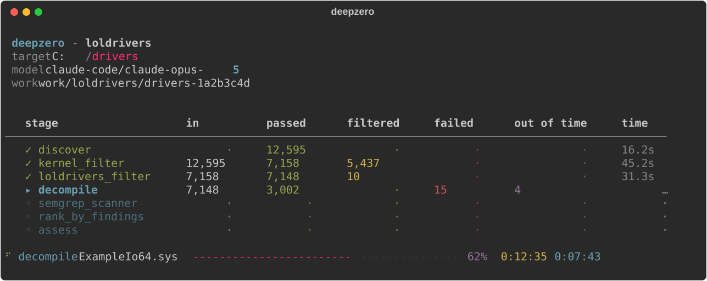
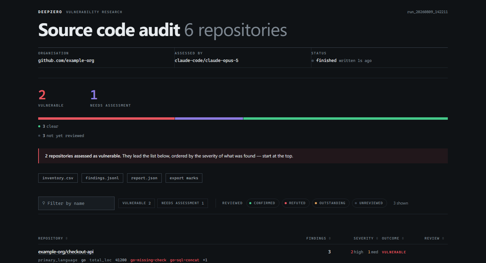
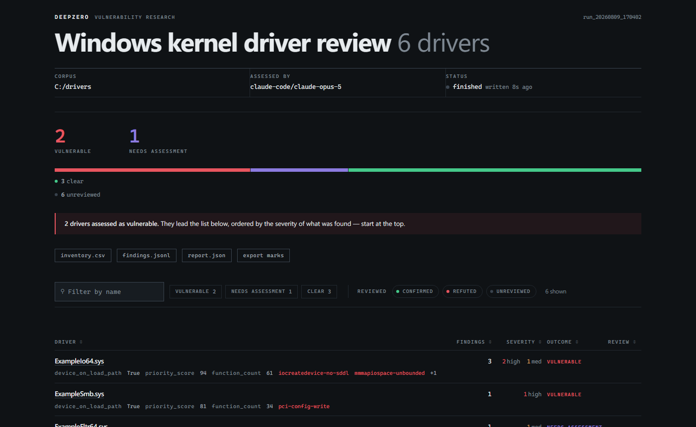

<div align="center">
  <br>
  
  <br><br>
  <p><b>自动化漏洞研究流水线引擎</b></p>
  <p>使用 YAML 定义流水线，并行处理样本，并恢复中断的运行。</p>
  <p>
    <a href="https://github.com/416rehman/DeepZero/actions"></a>
    <a href="https://github.com/416rehman/DeepZero/blob/main/LICENSE"></a>
    <a href="https://blog.ahmadz.ai/DeepZero/zh-CN/"></a>
    
    
  </p>
</div>

<br>

<div align="center">
  
</div>

<br>

<table align="center">
  <tr>
    <td width="50%"></td>
    <td width="50%"></td>
  </tr>
</table>

<div align="center">
  <sub>使用示例数据生成的报告。</sub>
</div>

<br>

<div align="center">
  <a href="README.md">English</a> | <b>简体中文</b> | <a href="README.fr.md">Français</a>
</div>

<br>

- **YAML 流水线** - 组合数据摄取、过滤、转换和 LLM 评估阶段。
- **并行执行** - 按阶段设置并发数。
- **状态保存** - 使用磁盘上的结果恢复中断的运行。
- **增量重跑** - 提示词、规则或配置变化后，重新运行受影响的阶段及其后续阶段。
- **LLM 后端** - 通过 [LiteLLM](https://github.com/BerriAI/litellm) 或 Claude Code CLI 使用 Jinja2 提示词。
- **HTML 报告** - 使用 `deepzero report` 生成自包含的报告。
- **自定义处理器** - 编写 Python 类，并在 YAML 中通过路径引用。
- **实验性 REST API** - 通过 HTTP 查询运行状态和样本数据。

---

## 📚 官方文档

[架构、流水线配置、命令行参考及自定义处理器](https://blog.ahmadz.ai/DeepZero/zh-CN/)。

---

## ⚡️ 快速开始

首次体验可先运行[本地演示](https://blog.ahmadz.ai/DeepZero/zh-CN/overview/quickstart.html)：只需 `python -m pip install -e .`，无需 API 密钥或外部工具。下方步骤用于配置两条安全分析流水线。

1. **克隆并安装 (要求 Python 3.11+)**
   ```bash
   git clone https://github.com/416rehman/DeepZero.git
   cd DeepZero
   python -m pip install -e ".[full]"
   ```

   请在克隆的仓库目录中运行以下命令。`full` 可选依赖包含用于 PE 解析的 LIEF 和用于 API 模型的 LiteLLM。仅安装引擎可使用 `python -m pip install -e .`。

   运行示例流水线前，请在同一环境中安装外部工具：

   - 两条安全分析流水线：PATH 中可用的 **Semgrep**（`python -m pip install semgrep`）和一个 LLM 后端。
   - 源代码审计：PATH 中可用的 **Git**。
   - 驱动分析：**Ghidra** 及该版本支持的 **JDK**，并在 `.env` 中将 `GHIDRA_INSTALL_DIR` 设置为你自己的安装目录。
   - 默认 LLM：安装 **Claude Code CLI** 并登录你自己的账户。它使用 CLI 的默认模型，无需 API 密钥。也可以在下方配置 API 模型及密钥。

   使用 WSL 时，请在 WSL 环境内安装并运行工具、Python 和 DeepZero。

2. **配置环境**
   ```bash
   cp .env.example .env
   ```

   在 PowerShell 中请使用 `Copy-Item .env.example .env`。两条流水线默认使用 `claude-code`，即 Claude Code CLI 的默认模型。要使用 LiteLLM 模型，可在 `.env` 中设置 `DEEPZERO_MODEL`，或使用 `-m` 仅覆盖一次运行。例如，`DEEPZERO_MODEL=openai/gpt-4o` 需要设置你自己的 `OPENAI_API_KEY`。

3. **运行一条流水线**
   ```bash
   # 磁盘上的内核驱动程序
   deepzero run ./drivers -p pipelines/loldrivers/pipeline.yaml --preflight

   # 或者源代码，来自一份仓库清单文件或一个存放检出目录的目录
   deepzero run repos.txt -p pipelines/source_audit/pipeline.yaml --preflight
   ```

   请将 `./drivers` 替换为你自己的驱动语料库路径，或创建每行一个仓库 URL 的 `repos.txt`。仓库中不包含这些示例输入。

   `deepzero validate pipelines/loldrivers/pipeline.yaml` / `deepzero validate pipelines/source_audit/pipeline.yaml`
   `--preflight` 在处理开始前检查 LLM 后端。

4. **查看结果**
   ```bash
   deepzero report -p loldrivers --open
   ```
   可以在运行过程中或结束后生成报告。`deepzero runs` 列出 `work/` 下的运行记录，也可通过 `--work-dir` 指定其他目录。不带参数的 `deepzero report` 会使用 `work/` 下唯一的运行记录；存在多条记录时，会提示选择。在脚本中请使用 `--work-dir` 指定运行记录。

有关详细的设置说明和示例语料库，请参阅[快速开始文档](https://blog.ahmadz.ai/DeepZero/zh-CN/overview/quickstart.html)。

---

## 📁 仓库目录结构

```text
src/deepzero/
├── cli.py               # click 命令组 (run, report, runs, status, validate, ...)
├── api/                 # REST API (starlette)
├── engine/              # 编排、状态持久化、流水线执行
└── stages/              # 内置处理器 (map, reduce, ingest)

processors/              # 外部处理器 (作为示例提供)
├── ghidra_decompile/    # ghidra 无头反编译器 (MapProcessor)
├── git_ingest/          # git 仓库发现与克隆 (IngestProcessor)
├── loldrivers_filter/   # loldrivers.io 哈希排除过滤器 (MapProcessor)
├── pe_ingest/           # PE 头部解析及驱动程序元数据提取器 (IngestProcessor)
└── semgrep_scanner/     # semgrep 批量扫描器 (BulkMapProcessor)

pipelines/
├── demo/                # 本地演示，无需 API 密钥或外部工具
├── loldrivers/          # BYOVD 内核驱动程序漏洞研究流水线
│   ├── pipeline.yaml
│   ├── assessment.j2    # LLM 提示词模板
│   └── rules/           # semgrep 规则
└── source_audit/        # 针对 git 仓库的源代码审计
    ├── pipeline.yaml
    ├── assessment.j2    # LLM 提示词模板
    └── rules/           # 覆盖八种语言的 136 条 semgrep 规则

docs/                    # 基于 Jekyll 的 GitHub Pages 官方文档
tests/                   # pytest 测试套件
```

---

## 🤝 参与贡献

CI 会在 GitHub Actions 上针对每个受支持的解释器运行测试套件。

提交代码之前，请运行代码格式化和安全检查：

```bash
ruff check . && ruff format --check . && bandit -ll -ii -c pyproject.toml -r .
```

在提交 Pull Request 之前，请阅读[贡献指南](CONTRIBUTING.md)和[行为准则](CODE_OF_CONDUCT.md)。

---

## 📄 开源协议

DeepZero 基于 [MIT 协议](LICENSE) 开源。
